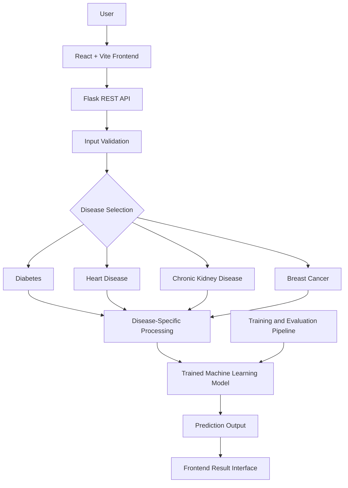

<div align="center">

# MediPredict AI

### AI-Based Multi-Disease Risk Prediction System

A unified machine learning platform for preliminary risk assessment across four disease categories.

<p>
  <a href="https://medipredict-ai-two.vercel.app/">
    
  </a>
  <a href="https://medipredict-ai-api.onrender.com/api/health">
    
  </a>
  <a href="LICENSE">
    
  </a>
</p>

**Machine Learning | Healthcare Research | Full-Stack Development**

</div>

---

> **Medical Disclaimer:** MediPredict AI is an academic research project designed for preliminary machine learning-based risk assessment. It is not a clinically validated diagnostic system and must not replace professional medical advice, diagnosis, or treatment.

## 1. Project Overview

MediPredict AI is a web-based multi-disease risk prediction platform that integrates four machine learning classification workflows into a unified application.

The system accepts disease-specific input parameters, processes them through trained machine learning models, and presents prediction results through an interactive web interface.

The project explores the integration of machine learning, backend API development, frontend engineering, and model evaluation within a healthcare-oriented application.

### Supported Disease Categories

| Disease | Prediction Task |
|---|---|
| Diabetes | Binary risk classification |
| Heart Disease | Binary risk classification |
| Chronic Kidney Disease (CKD) | Binary classification |
| Breast Cancer | Benign / Malignant classification |

## 2. Key Features

- Unified interface for four disease prediction workflows.
- Disease-specific input forms.
- Machine learning-based prediction workflows.
- Independent model selection for each disease.
- Interactive prediction result interface.
- Model performance analytics.
- Saved assessment interface.
- Model evaluation and CSV export interface.
- Flask REST API integration.
- Automated backend testing.
- Academic and technical documentation.

## 3. Live Application

Explore the deployed application:

| Component | Link |
|---|---|
| Frontend Application | [MediPredict AI](https://medipredict-ai-two.vercel.app/) |
| Backend API | [MediPredict AI API](https://medipredict-ai-api.onrender.com) |
| API Health | [Health Endpoint](https://medipredict-ai-api.onrender.com/api/health) |
| GitHub Repository | [Source Code](https://github.com/devloperdevesh/ai-multidisease-prediction) |

Deployment availability may vary depending on hosting conditions.

## 4. Application Screenshots

### Main Dashboard

<p align="center">
  
</p>

### Disease Prediction Interfaces

**Diabetes Prediction**

<p align="center">
  
</p>

**Heart Disease Prediction**

<p align="center">
  
</p>

**Chronic Kidney Disease Prediction**

<p align="center">
  
</p>

**Breast Cancer Prediction**

<p align="center">
  
</p>

### Prediction Results

<p align="center">
  
</p>

### Model Analytics

<p align="center">
  
</p>

<p align="center">
  
</p>

### Saved Assessments

<p align="center">
  
</p>

### Model Evaluation Export

<p align="center">
  
</p>

## 5. Machine Learning Methodology

The project follows a structured machine learning workflow:

1. Dataset acquisition.
2. Dataset inspection and quality assessment.
3. Missing and invalid value handling.
4. Data preprocessing and transformation.
5. Categorical feature encoding where required.
6. Feature scaling where required.
7. Training and testing data separation.
8. Model training and comparison.
9. Performance evaluation.
10. Best-model selection and application integration.

Disease-specific preprocessing is applied because each dataset contains different feature types and characteristics.

### Selected Models

The recorded evaluation results identify **Logistic Regression** as the selected model for all four disease workflows.

### Recorded Test-Set Performance

Source: `reports/results/best_models.json`

| Disease | Selected Model | Accuracy | Precision | Recall | F1-Score | ROC-AUC |
|---|---|---:|---:|---:|---:|---:|
| Diabetes | Logistic Regression | 70.78% | 60.00% | 50.00% | 54.55% | 81.30% |
| Heart Disease | Logistic Regression | 86.89% | 81.25% | 92.86% | 86.67% | 95.13% |
| CKD | Logistic Regression | 98.75% | 100.00% | 98.00% | 98.99% | 100.00% |
| Breast Cancer | Logistic Regression | 96.49% | 97.50% | 92.86% | 95.12% | 99.60% |

### Cross-Validation ROC-AUC

| Disease | Mean CV ROC-AUC |
|---|---:|
| Diabetes | 84.34% |
| Heart Disease | 89.60% |
| CKD | 100.00% |
| Breast Cancer | 99.58% |

### Evaluation Metrics

| Metric | Purpose |
|---|---|
| Accuracy | Overall prediction correctness |
| Precision | Correctness of positive predictions |
| Recall | Identification of actual positive cases |
| F1-Score | Balance between precision and recall |
| ROC-AUC | Class discrimination performance |

**Research Integrity:** These are recorded dataset evaluation results, not evidence of real-world clinical performance. The very high CKD result requires additional investigation into dataset provenance, potential data leakage, split methodology, and independent validation.

## 6. System Architecture



The architecture separates the frontend, backend API, disease-specific processing, and trained model artifacts.

## 7. Technology Stack

| Layer | Technologies |
|---|---|
| Programming Languages | Python, JavaScript |
| Frontend | React, Vite, HTML, CSS |
| Backend | Flask, REST API |
| Machine Learning | Scikit-learn, XGBoost |
| Data Processing | Pandas, NumPy |
| Model Persistence | Joblib |
| Testing | Pytest |
| Frontend Hosting | Vercel |
| Backend Hosting | Render |
| Version Control | Git, GitHub |

## 8. Backend API

**Production API Base URL**

```text
https://medipredict-ai-api.onrender.com
```

### Available Endpoints

| Endpoint | Description |
|---|---|
| `/api/health` | Backend health and model status |
| `/api/diseases` | Supported disease information |
| `/api/metrics` | Model evaluation metrics |

### Health Check

```bash
curl https://medipredict-ai-api.onrender.com/api/health
```

Previously recorded health response:

```json
{
  "models_loaded": [
    "diabetes",
    "heart",
    "ckd",
    "breast_cancer"
  ],
  "service": "MediPredict AI API",
  "status": "healthy"
}
```

## 9. Testing and Validation

### Backend Tests

Run the backend test suite:

```bash
python -m pytest -q
```

Previously recorded result:

```text
41 passed
```

### Frontend Production Build

```bash
npm --prefix frontend run build
```

Previously recorded build information:

- Vite 8.3.5.
- 2,053 modules transformed.
- JavaScript output approximately 283.45 kB.
- CSS output approximately 51.94 kB.
- Production build completed successfully.

These are historical execution results and may change after subsequent code modifications.

## 10. Local Development Setup

### Prerequisites

Make sure the following tools are installed:

- Python 3.x
- Node.js
- npm
- Git

### Step 1: Clone the Repository

```bash
git clone https://github.com/devloperdevesh/ai-multidisease-prediction.git
```

```bash
cd ai-multidisease-prediction
```

### Step 2: Create a Python Virtual Environment

**Windows PowerShell**

```powershell
python -m venv .venv
```

Activate the environment:

```powershell
.\.venv\Scripts\Activate.ps1
```

### Step 3: Install Backend Dependencies

```bash
pip install -r requirements.txt
```

### Step 4: Install Frontend Dependencies

```bash
npm --prefix frontend install
```

### Step 5: Configure Environment Variables

Create a local `.env` file when required by the application.

Example frontend API configuration:

```env
VITE_API_BASE_URL=http://127.0.0.1:5000
```

Never commit credentials, secret keys, or private environment files to version control.

### Step 6: Start the Backend

```bash
python -m app.api.server
```

### Step 7: Start the Frontend

Open another terminal and run:

```bash
npm --prefix frontend run dev
```

Open the local development URL provided by Vite.

### Step 8: Run Tests

```bash
python -m pytest -q
```

## 11. Repository Structure

```text
ai-multidisease-prediction/
│
├── app/
│   ├── api/
│   ├── static/
│   └── templates/
│
├── data/
│   ├── raw/
│   └── processed/
│
├── docs/
│   ├── screenshots/
│   ├── 01_literature_survey.md
│   ├── 02_hld.md
│   ├── 03_lld.md
│   ├── 04_dataset_documentation.md
│   ├── 05_preprocessing_methodology.md
│   └── ...
│
├── frontend/
│   ├── public/
│   ├── src/
│   ├── index.html
│   ├── package.json
│   └── vite.config.js
│
├── models/
│   ├── diabetes/
│   ├── heart/
│   ├── ckd/
│   └── breast_cancer/
│
├── reports/
│   └── results/
│       └── best_models.json
│
├── src/
├── tests/
├── requirements.txt
├── render.yaml
├── vercel.json
├── LICENSE
└── README.md
```

## 12. Project Documentation

| Document | Description |
|---|---|
| Literature Survey | Existing research and research gap |
| High-Level Design | System architecture and data flow |
| Low-Level Design | Module-level implementation design |
| Dataset Documentation | Dataset information and structure |
| Preprocessing Methodology | Data cleaning and transformation |
| Test Cases | Functional and validation testing |
| Initial UI Design | Interface design |
| Complexity, Cost, Social & Health | Academic evaluation |
| SDG, Legal & Environmental | Sustainability and legal considerations |
| Project Type | Project classification |
| Monthly Progress | Project progress |
| Review 2 Checklist | Academic review checklist |

## 13. Limitations and Responsible Use

- Public datasets may not represent all patient populations.
- Model performance depends on dataset quality and methodology.
- High test-set scores do not establish clinical reliability.
- The system has not undergone independent clinical validation.
- Predictions must not be used for treatment decisions.
- Real-world deployment requires privacy, security, regulatory, and clinical review.
- Hosting storage limitations may affect persistence of saved assessment information.

## 14. Future Scope

- Independent external model validation.
- Dataset provenance and leakage investigation.
- Explainable AI using SHAP or LIME.
- Larger and more representative datasets.
- Model calibration and threshold analysis.
- Improved privacy and secure data storage.
- Persistent database infrastructure.
- Model monitoring and drift detection.
- Clinical collaboration and validation.

## 15. Team and Contributions

The project was developed through collaboration across technical implementation, research, interface development, and academic documentation.

| Team Member | Role | Primary Responsibilities |
|---|---|---|
| Devesh Chauhan | Technical Lead | System architecture, technical design, backend engineering, frontend-backend integration, ML workflow integration, technical coordination and deployment coordination |
| Karan Kumar Tiwari | UI / Frontend Developer | User interface design, visual implementation and frontend development |
| Payal Chauhan | Research & Presentation | Research work, presentation preparation and academic presentation |
| Mamta Tiwari | Research & Documentation | Literature review, research paper reading, base-paper selection, synopsis and academic documentation |

### Technical Leadership — Devesh Chauhan

Responsible for the overall technical direction and coordination of the project, including:

- System architecture and technical design.
- Backend API engineering and integration.
- Frontend-backend integration.
- Machine learning workflow integration.
- Technical debugging and implementation coordination.
- Deployment coordination and application-level validation.

### Academic Guidance

**Project Guide:** Mr. Anurag Gupta

Assistant Professor, Department of Computer Science.

**Institution:** ITS Engineering College, Greater Noida.

**University:** Dr. A.P.J. Abdul Kalam Technical University, Lucknow, Uttar Pradesh.

## 16. Academic Relevance

MediPredict AI explores the application of machine learning techniques in healthcare-related risk assessment.

The project aligns with:

- **SDG 3:** Good Health and Well-Being.
- **SDG 9:** Industry, Innovation and Infrastructure.

Developed as a final-year major research project, the system serves as an academic demonstration of machine learning, software engineering, and healthcare-oriented application development.

## 17. License

This project is released under the MIT License.

See [LICENSE](LICENSE) for complete license information.

---

<div align="center">

### MediPredict AI

**Machine Learning | Healthcare Research | Software Engineering**

[Live Application](https://medipredict-ai-two.vercel.app/) · [GitHub Repository](https://github.com/devloperdevesh/ai-multidisease-prediction)

</div>
