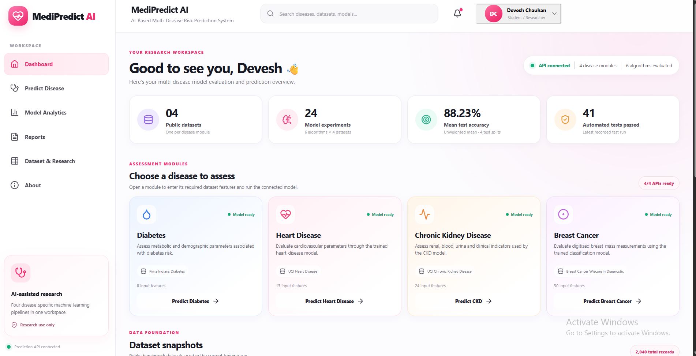
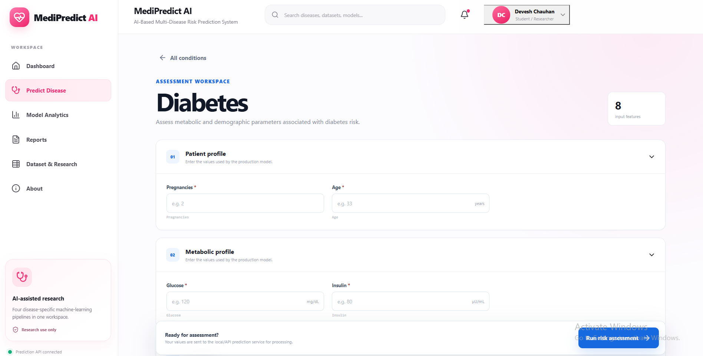
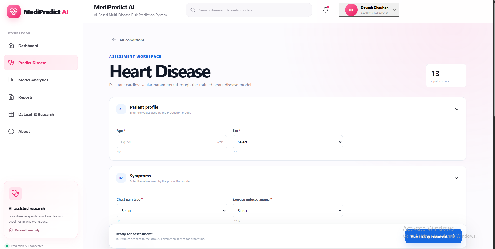
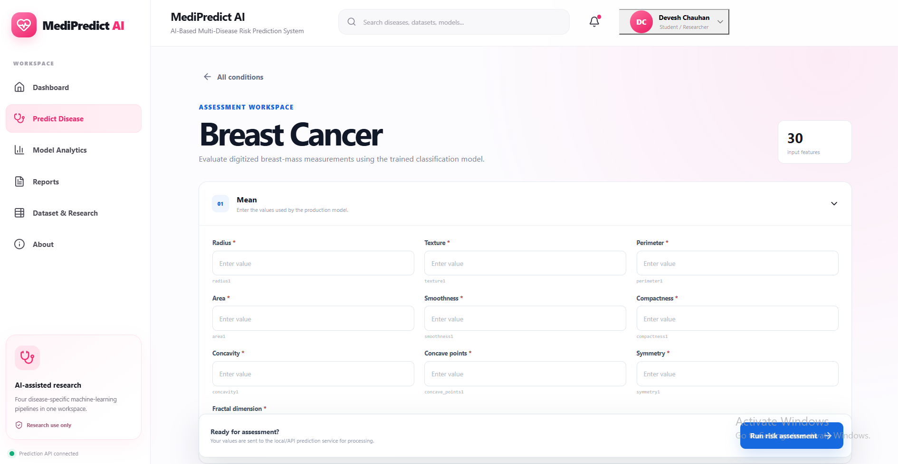
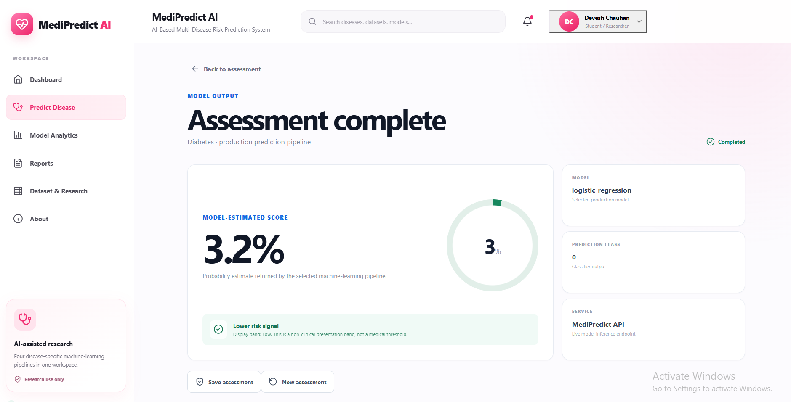
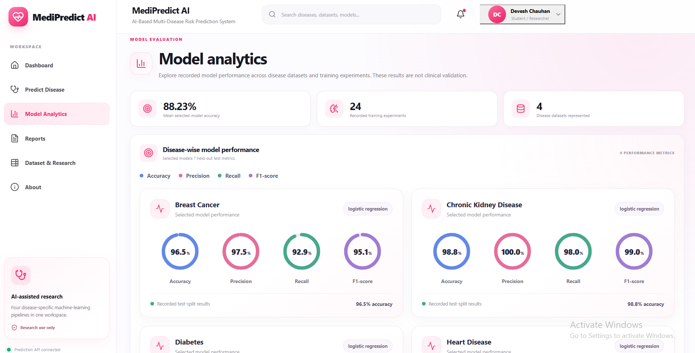
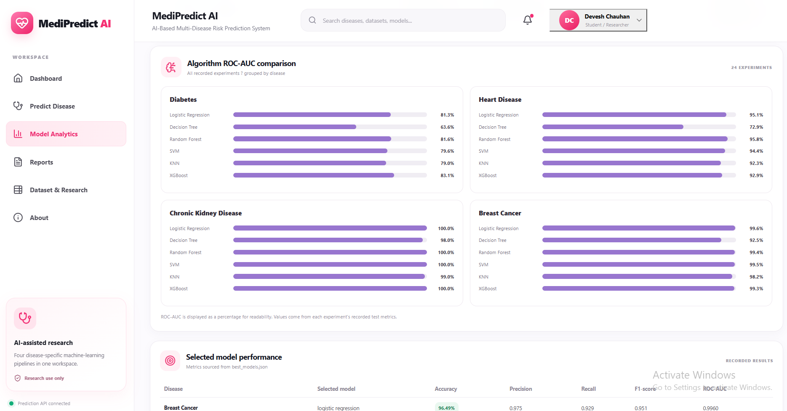
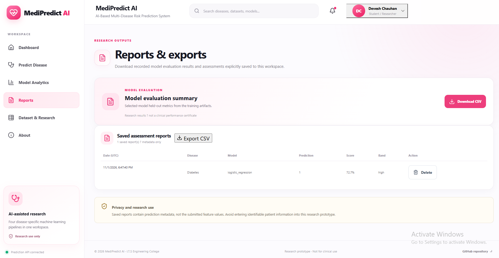
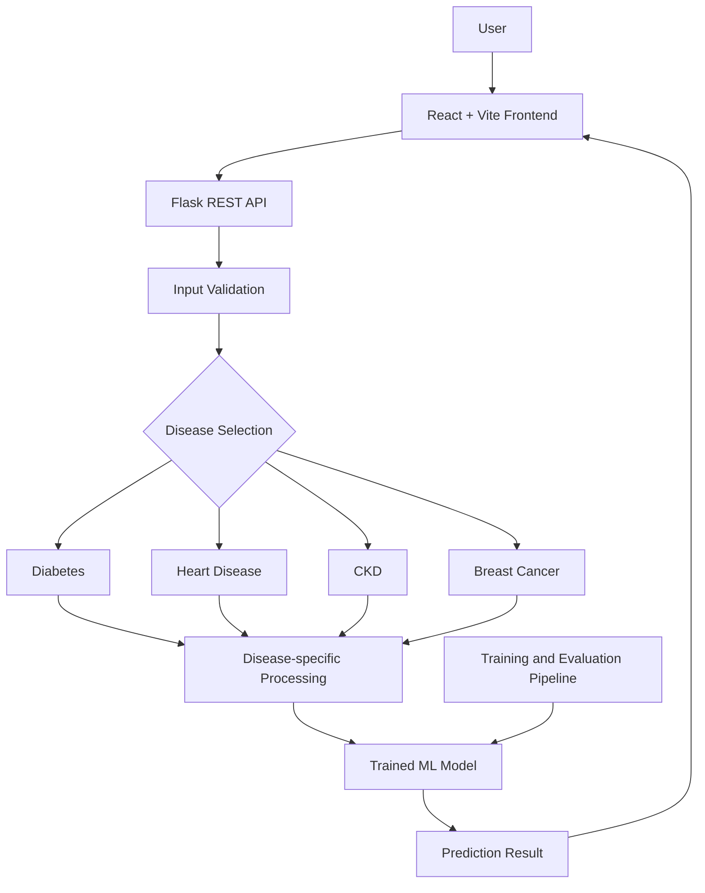

<div align="center">

# MediPredict AI

### AI-Based Multi-Disease Risk Prediction System

**A unified machine learning research platform for four disease prediction workflows.**

<p>
<a href="https://medipredict-ai-two.vercel.app/">

</a>
<a href="https://medipredict-ai-api.onrender.com/api/health">

</a>
<a href="https://github.com/devloperdevesh/ai-multidisease-prediction">

</a>
<a href="LICENSE">

</a>
</p>

**4 Disease Categories · 6 Algorithms · 24 Model Experiments**

</div>

---

> **Medical disclaimer:** This is an academic machine learning research project. It is not clinically validated and must not be used as a substitute for professional medical advice, diagnosis, or treatment.

## Project at a glance

MediPredict AI combines four disease-specific machine learning workflows with a web application. Users can enter disease-related parameters and receive a model-generated classification through a unified interface.

| Disease category | Prediction task |
|---|---|
| Diabetes | Binary risk classification |
| Heart Disease | Binary risk classification |
| Chronic Kidney Disease (CKD) | Binary classification |
| Breast Cancer | Benign / Malignant classification |

## Application preview

<table>
<tr><td width="50%" align="center"><b>Dashboard</b><br></td><td width="50%" align="center"><b>Diabetes Form</b><br></td></tr>
<tr><td width="50%" align="center"><b>Heart Disease Form</b><br></td><td width="50%" align="center"><b>Breast Cancer Form</b><br></td></tr>
<tr><td width="50%" align="center"><b>Prediction Result</b><br></td><td width="50%" align="center"><b>Model Analytics</b><br></td></tr>
<tr><td width="50%" align="center"><b>ROC-AUC Analytics</b><br></td><td width="50%" align="center"><b>Saved Assessments</b><br></td></tr>
<tr><td width="50%" align="center"><b>CSV Export</b><br></td><td width='50%'></td></tr>

</table>

## Key features

- Unified web interface for four disease workflows.
- Disease-specific input forms and preprocessing.
- Six classification algorithms evaluated per disease.
- 24 recorded model experiments.
- Model performance comparison and analytics.
- Flask REST API integration.
- Saved assessment and evaluation interfaces.
- Automated backend test suite.
- Exportable research evaluation results.

## Model evaluation

The following table shows the Logistic Regression experiment for each disease, based on `reports/results/model_comparison.csv`.

| Disease | Model | Accuracy | Precision | Recall | F1-Score | ROC-AUC |
| --- | --- | --- | --- | --- | --- | --- |
| Diabetes | logistic_regression | 70.78% | 60.00% | 50.00% | 54.55% | 81.30% |
| Heart Disease | logistic_regression | 86.89% | 81.25% | 92.86% | 86.67% | 96.65% |
| Chronic Kidney Disease | logistic_regression | 100.00% | 100.00% | 100.00% | 100.00% | 100.00% |
| Breast Cancer | logistic_regression | 96.49% | 97.50% | 92.86% | 95.12% | 99.60% |

**Important:** The selected-model results above are test-set metrics from the recorded experiments. They do not establish clinical performance.

### All 24 model experiments

All experiment records are retained below. Expand this section to inspect the individual algorithms, dataset split sizes, cross-validation ROC-AUC, classification metrics and confusion-matrix counts.

<details>
<summary><b>View complete 24-model comparison table</b></summary>

| Disease | Algorithm | Dataset Rows | Train Rows | Test Rows | CV ROC-AUC Mean | CV ROC-AUC Std | Accuracy | Precision | Recall | F1 | ROC-AUC | TN | FP | FN | TP |
| --- | --- | --- | --- | --- | --- | --- | --- | --- | --- | --- | --- | --- | --- | --- | --- |
| Breast Cancer | decision_tree | 569 | 455 | 114 | 0.9172 | 0.0375 | 92.98% | 90.48% | 90.48% | 90.48% | 92.46% | 68 | 4 | 4 | 38 |
| Breast Cancer | knn | 569 | 455 | 114 | 0.9871 | 0.0136 | 95.61% | 97.44% | 90.48% | 93.83% | 98.23% | 71 | 1 | 4 | 38 |
| Breast Cancer | logistic_regression | 569 | 455 | 114 | 0.9958 | 0.0047 | 96.49% | 97.50% | 92.86% | 95.12% | 99.60% | 71 | 1 | 3 | 39 |
| Breast Cancer | random_forest | 569 | 455 | 114 | 0.9880 | 0.0073 | 97.37% | 100.00% | 92.86% | 96.30% | 99.44% | 72 | 0 | 3 | 39 |
| Breast Cancer | svm | 569 | 455 | 114 | 0.9949 | 0.0050 | 97.37% | 100.00% | 92.86% | 96.30% | 99.47% | 72 | 0 | 3 | 39 |
| Breast Cancer | xgboost | 569 | 455 | 114 | 0.9928 | 0.0050 | 96.49% | 100.00% | 90.48% | 95.00% | 99.31% | 72 | 0 | 4 | 38 |
| Chronic Kidney Disease | decision_tree | 400 | 320 | 80 | 0.9692 | 0.0141 | 98.75% | 100.00% | 98.00% | 98.99% | 99.00% | 30 | 0 | 1 | 49 |
| Chronic Kidney Disease | knn | 400 | 320 | 80 | 0.9961 | 0.0049 | 97.50% | 100.00% | 96.00% | 97.96% | 99.93% | 30 | 0 | 2 | 48 |
| Chronic Kidney Disease | logistic_regression | 400 | 320 | 80 | 1.0000 | 0.0000 | 100.00% | 100.00% | 100.00% | 100.00% | 100.00% | 30 | 0 | 0 | 50 |
| Chronic Kidney Disease | random_forest | 400 | 320 | 80 | 0.9998 | 0.0004 | 100.00% | 100.00% | 100.00% | 100.00% | 100.00% | 30 | 0 | 0 | 50 |
| Chronic Kidney Disease | svm | 400 | 320 | 80 | 1.0000 | 0.0000 | 100.00% | 100.00% | 100.00% | 100.00% | 100.00% | 30 | 0 | 0 | 50 |
| Chronic Kidney Disease | xgboost | 400 | 320 | 80 | 0.9983 | 0.0017 | 100.00% | 100.00% | 100.00% | 100.00% | 100.00% | 30 | 0 | 0 | 50 |
| Diabetes | decision_tree | 768 | 614 | 154 | 0.6510 | 0.0148 | 68.18% | 55.32% | 48.15% | 51.49% | 63.57% | 79 | 21 | 28 | 26 |
| Diabetes | knn | 768 | 614 | 154 | 0.7843 | 0.0373 | 75.32% | 66.00% | 61.11% | 63.46% | 78.99% | 83 | 17 | 21 | 33 |
| Diabetes | logistic_regression | 768 | 614 | 154 | 0.8434 | 0.0185 | 70.78% | 60.00% | 50.00% | 54.55% | 81.30% | 82 | 18 | 27 | 27 |
| Diabetes | random_forest | 768 | 614 | 154 | 0.8209 | 0.0209 | 74.03% | 65.91% | 53.70% | 59.18% | 81.60% | 85 | 15 | 25 | 29 |
| Diabetes | svm | 768 | 614 | 154 | 0.8333 | 0.0228 | 74.03% | 65.22% | 55.56% | 60.00% | 79.64% | 84 | 16 | 24 | 30 |
| Diabetes | xgboost | 768 | 614 | 154 | 0.7981 | 0.0192 | 74.68% | 65.31% | 59.26% | 62.14% | 83.09% | 83 | 17 | 22 | 32 |
| Heart Disease | decision_tree | 303 | 242 | 61 | 0.7490 | 0.0638 | 75.41% | 66.67% | 92.86% | 77.61% | 76.73% | 20 | 13 | 2 | 26 |
| Heart Disease | knn | 303 | 242 | 61 | 0.8832 | 0.0405 | 86.89% | 83.33% | 89.29% | 86.21% | 92.75% | 28 | 5 | 3 | 25 |
| Heart Disease | logistic_regression | 303 | 242 | 61 | 0.8968 | 0.0159 | 86.89% | 81.25% | 92.86% | 86.67% | 96.65% | 27 | 6 | 2 | 26 |
| Heart Disease | random_forest | 303 | 242 | 61 | 0.8934 | 0.0310 | 85.25% | 78.79% | 92.86% | 85.25% | 94.16% | 26 | 7 | 2 | 26 |
| Heart Disease | svm | 303 | 242 | 61 | 0.8798 | 0.0275 | 85.25% | 78.79% | 92.86% | 85.25% | 95.24% | 26 | 7 | 2 | 26 |
| Heart Disease | xgboost | 303 | 242 | 61 | 0.8737 | 0.0192 | 83.61% | 76.47% | 92.86% | 83.87% | 91.23% | 25 | 8 | 2 | 26 |

</details>

### Repeated cross-validation audit

The following table is generated from `reports/results/repeated_cv_audit.csv`.

| Disease | Rows | Features | Accuracy Mean | Precision Mean | Recall Mean | F1 Mean | ROC-AUC Mean | ROC-AUC Std |
| --- | --- | --- | --- | --- | --- | --- | --- | --- |
| Diabetes | 768 | 8 | 76.69% | 71.35% | 55.80% | 62.42% | 83.54% | 0.0275 |
| Heart Disease | 303 | 13 | 83.53% | 84.59% | 79.00% | 81.42% | 90.30% | 0.0363 |
| Chronic Kidney Disease | 400 | 24 | 99.70% | 99.88% | 99.64% | 99.76% | 100.00% | 0.0001 |
| Breast Cancer | 569 | 30 | 97.89% | 98.56% | 95.76% | 97.11% | 99.48% | 0.0053 |

### Evaluation definitions

| Metric | Meaning |
|---|---|
| Accuracy | Overall proportion of correct predictions |
| Precision | Correctness of positive predictions |
| Recall | Ability to identify actual positive cases |
| F1-score | Harmonic mean of precision and recall |
| ROC-AUC | Ability to distinguish between classes |
| Confusion matrix | True negatives, false positives, false negatives and true positives |

### Downloadable experiment evidence

| Resource | Description |
|---|---|
| [Complete Excel evaluation](reports/results/medipredict_model_evaluation.xlsx) | All 24 experiments, CV audit and best-model source |
| [Model comparison CSV](reports/results/model_comparison.csv) | Original experiment metrics |
| [Best models JSON](reports/results/best_models.json) | Selected model records |
| [Detailed evaluation report](docs/MODEL_EVALUATION_EVIDENCE.md) | Expanded research evidence |
| [Dataset audit](reports/results/dataset_audit.json) | Dataset inspection results |
| [Training results](reports/results/model_training_results.json) | Training experiment records |

## Research methodology

1. Dataset acquisition and inspection.
2. Data quality and missing-value assessment.
3. Disease-specific preprocessing.
4. Feature encoding and scaling where required.
5. Training and test split.
6. Six algorithm experiments per disease.
7. Cross-validation and test-set evaluation.
8. Model comparison and selection.
9. Model persistence and API integration.

### Algorithms evaluated

- Logistic Regression
- Decision Tree
- Random Forest
- Support Vector Machine (SVM)
- K-Nearest Neighbors (KNN)
- XGBoost

## System architecture



## Technology stack

| Layer | Technologies |
|---|---|
| Languages | Python, JavaScript |
| Frontend | React, Vite, HTML, CSS |
| Backend | Flask, REST API |
| Machine Learning | Scikit-learn, XGBoost |
| Data Processing | Pandas, NumPy |
| Model Persistence | Joblib |
| Testing | Pytest |
| Deployment | Vercel, Render |
| Version Control | Git, GitHub |

## Live services

| Component | Link |
|---|---|
| Frontend | [MediPredict AI](https://medipredict-ai-two.vercel.app/) |
| Backend | [Production API](https://medipredict-ai-api.onrender.com) |
| Health endpoint | [API Health](https://medipredict-ai-api.onrender.com/api/health) |
| Source code | [GitHub Repository](https://github.com/devloperdevesh/ai-multidisease-prediction) |

Service availability may vary depending on hosting conditions.

## Local setup

### 1. Clone the repository

```bash
git clone https://github.com/devloperdevesh/ai-multidisease-prediction.git
cd ai-multidisease-prediction
```

### 2. Create and activate a virtual environment

```powershell
python -m venv .venv
.\.venv\Scripts\Activate.ps1
```

### 3. Install Python dependencies

```bash
pip install -r requirements.txt
```

### 4. Install frontend dependencies

```bash
npm --prefix frontend install
```

### 5. Start the backend

```bash
python -m app.api.server
```

### 6. Start the frontend in another terminal

```bash
npm --prefix frontend run dev
```

### 7. Run tests

```bash
python -m pytest -q
```

## Repository structure

```text
ai-multidisease-prediction/
├── app/                  # Backend application
├── data/                 # Raw and processed datasets
├── docs/
│   ├── screenshots/     # Application screenshots
│   └── ...              # Research and design documents
├── frontend/             # React + Vite application
├── models/               # Saved disease-specific models
├── reports/
│   └── results/          # Experiment metrics and audits
├── src/                  # Training and ML source code
├── tests/                # Automated tests
├── requirements.txt
├── LICENSE
└── README.md
```

## Project team

| Team Member | Role | Responsibilities |
|---|---|---|
| Devesh Chauhan | Technical Lead | Architecture, backend, integration, ML workflow and technical coordination |
| Karan Kumar Tiwari | UI / Frontend Developer | Interface design and frontend development |
| Payal Chauhan | Research & Presentation | Research and presentation preparation |
| Mamta Tiwari | Research & Documentation | Literature review and academic documentation |

**Project Guide:** Mr. Anurag Gupta, Assistant Professor, Department of Computer Science.

**Institution:** ITS Engineering College, Greater Noida.

**University:** Dr. A.P.J. Abdul Kalam Technical University, Lucknow.

## Limitations and responsible use

- Public benchmark datasets may not represent all patient populations.
- High test-set performance does not establish clinical reliability.
- CKD's unusually high recorded metrics require further leakage, duplicate-record and independent validation checks.
- The project has not undergone independent clinical validation.
- Predictions must not be used for treatment decisions.
- Real-world use requires privacy, security, regulatory and clinical review.

## Future scope

- Independent external dataset validation.
- Explainable AI using SHAP or LIME.
- Model calibration and decision-threshold analysis.
- Dataset provenance and leakage investigation.
- Model monitoring and drift detection.
- Secure and persistent assessment storage.
- Clinical collaboration and validation.

## License

Released under the [MIT License](LICENSE).

---

<div align="center">

**MediPredict AI**

*Machine Learning · Healthcare Research · Full-Stack Engineering*

[Live Demo](https://medipredict-ai-two.vercel.app/) · [GitHub](https://github.com/devloperdevesh/ai-multidisease-prediction)

</div>
