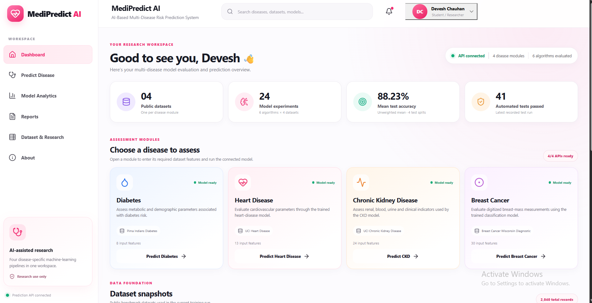
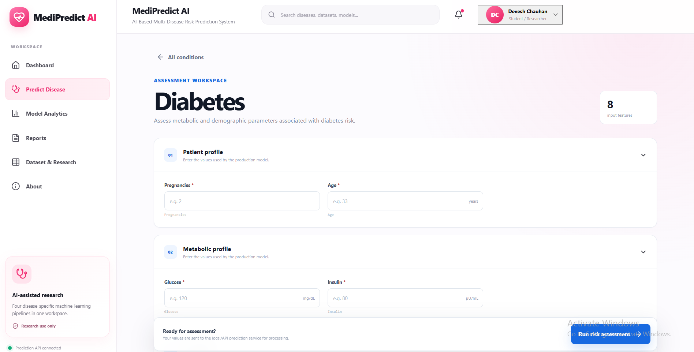
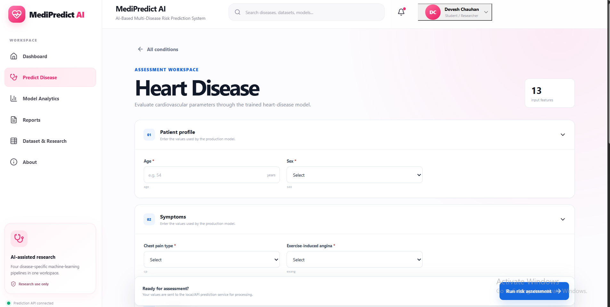
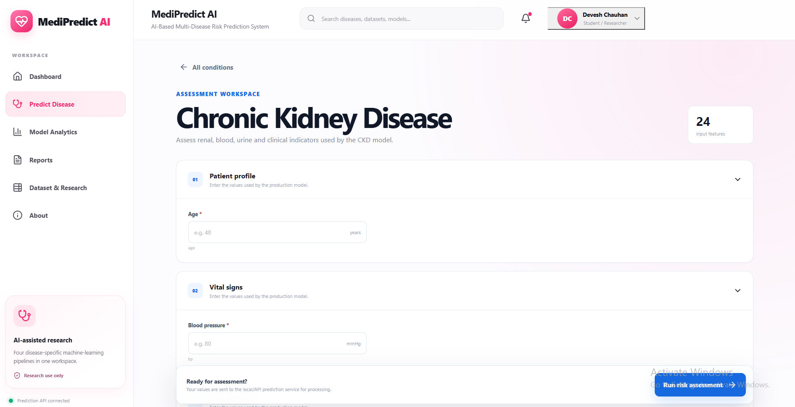
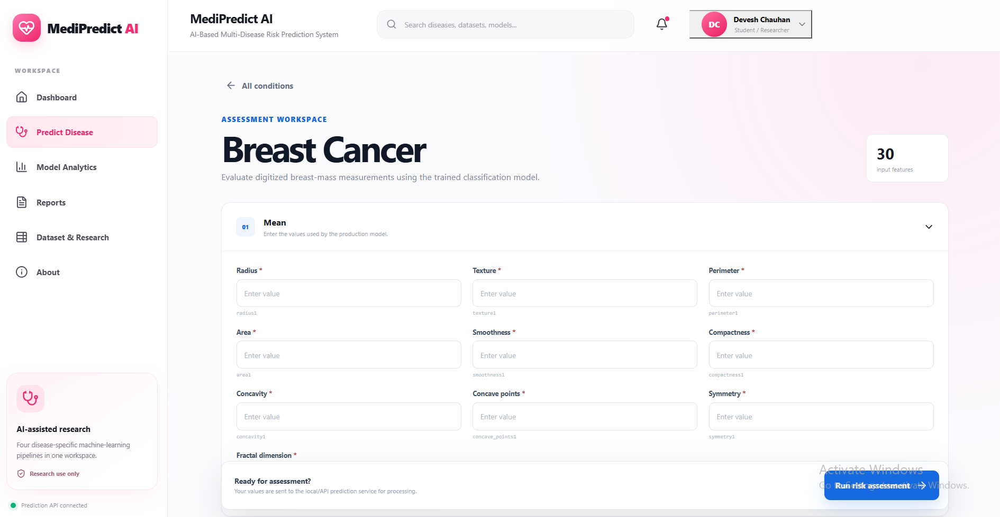
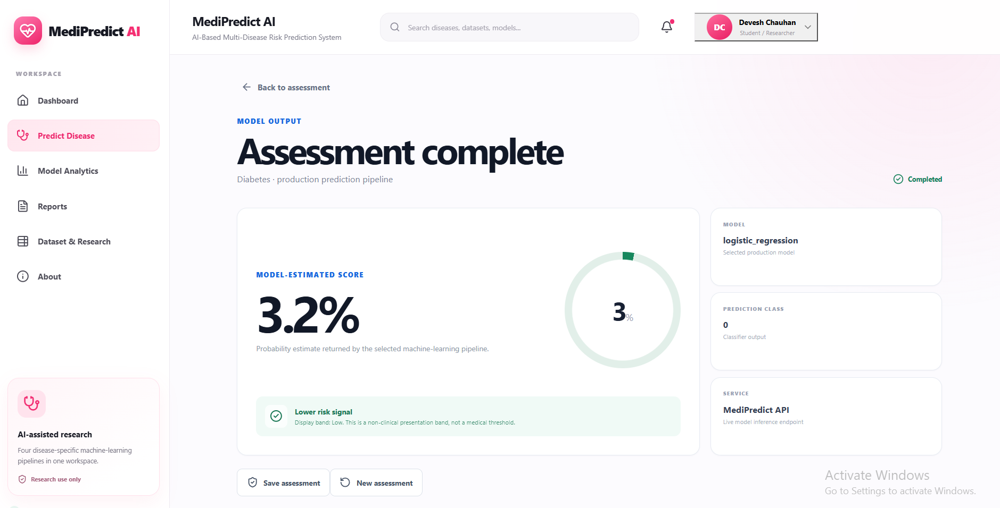
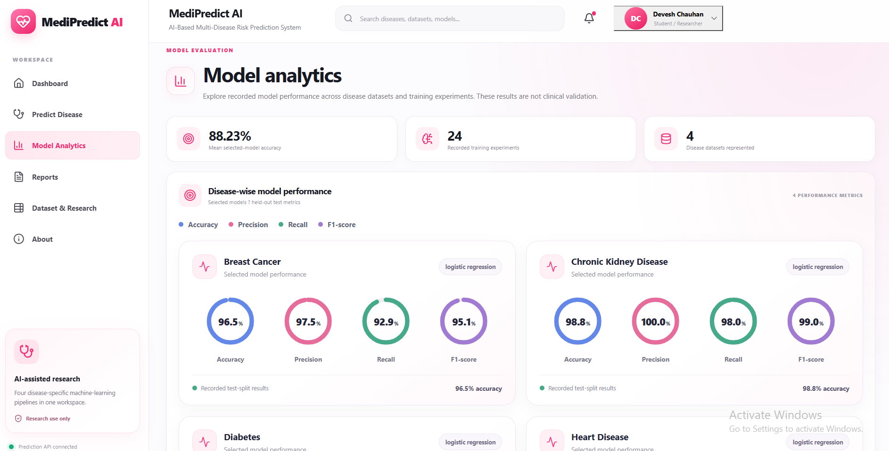
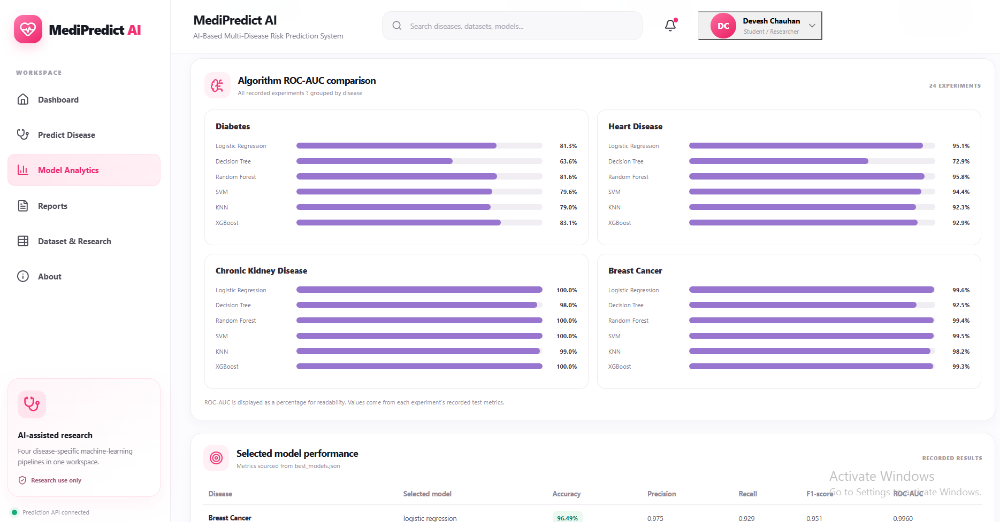
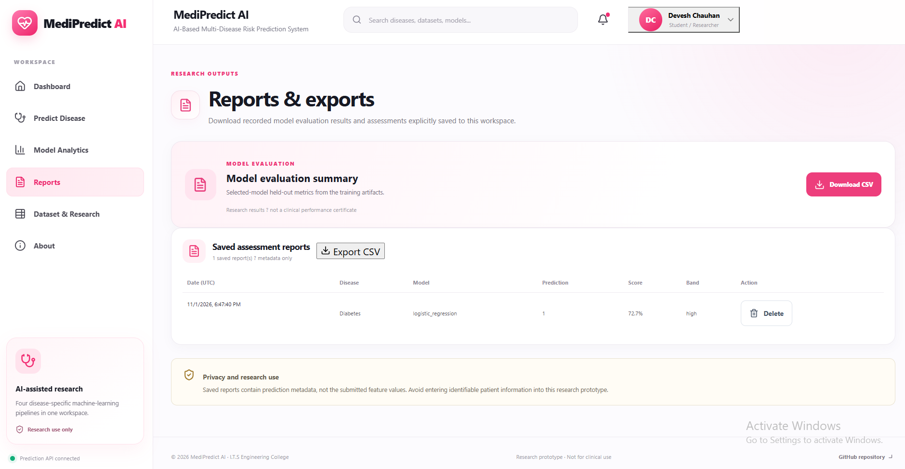
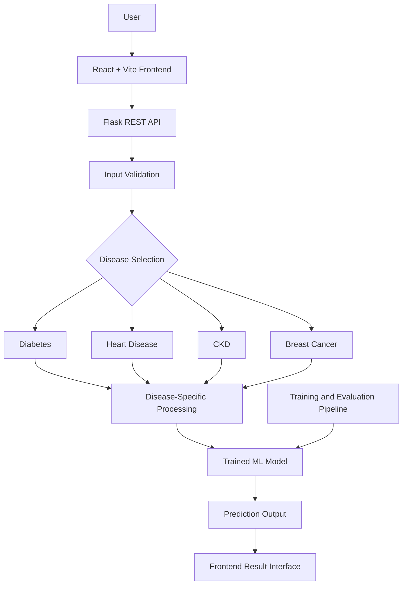

# MediPredict AI
### AI-Based Multi-Disease Risk Prediction System

<p align="center">
  <strong>A unified machine learning platform for preliminary risk assessment across four diseases.</strong>
</p>

<p align="center">
  
</p>

<p align="center">
  
  
  
  
  
</p>

<p align="center">
  <a href="https://github.com/devloperdevesh/ai-multidisease-prediction">GitHub Repository</a> •
  <a href="https://medipredict-ai-api.onrender.com/api/health">Backend Health</a> •
  <a href="docs/">Documentation</a>
</p>

---

> **Medical Disclaimer:** MediPredict AI is an academic research project for preliminary machine learning-based risk assessment. It is not a clinically validated diagnostic tool and must not replace professional medical advice, diagnosis, or treatment.

## 1. Overview

MediPredict AI is a web-based multi-disease prediction system that integrates four machine learning classification workflows into one platform.

The application provides disease-specific input forms, processes clinical parameters, generates model predictions, and presents model evaluation information through a unified interface.

### Diseases Supported

| Disease | Prediction Task |
|---|---|
| Diabetes | Binary risk classification |
| Heart Disease | Binary risk classification |
| Chronic Kidney Disease (CKD) | Binary classification |
| Breast Cancer | Benign / Malignant classification |

## 2. Key Features

- Four disease prediction workflows in one platform.
- Disease-specific clinical input forms.
- Machine learning model evaluation.
- Independent model selection for each disease.
- Prediction result interface.
- Model performance analytics.
- Saved assessment interface.
- Model evaluation CSV export interface.
- Flask-based REST API.
- Automated testing with Pytest.
- Academic and technical documentation.

## 3. Application Screenshots

### Dashboard

<p align="center">
  
</p>

### Disease Input Forms

**Diabetes**

<p align="center">
  
</p>

**Heart Disease**

<p align="center">
  
</p>

**Chronic Kidney Disease**

<p align="center">
  
</p>

**Breast Cancer**

<p align="center">
  
</p>

### Prediction Result

<p align="center">
  
</p>

### Model Analytics

**Performance Overview**

<p align="center">
  
</p>

**ROC-AUC Comparison**

<p align="center">
  
</p>

### Saved Assessments

<p align="center">
  
</p>

### Evaluation Export

<p align="center">
  
</p>

---

## 4. Machine Learning Performance

The following metrics are taken from the repository's recorded evaluation file:

`reports/results/best_models.json`

The selected model recorded for all four disease tasks is Logistic Regression.

### Recorded Test-Set Results

| Disease | Selected Model | Accuracy | Precision | Recall | F1-Score | ROC-AUC |
|---|---|---:|---:|---:|---:|---:|
| Diabetes | Logistic Regression | 70.78% | 60.00% | 50.00% | 54.55% | 81.30% |
| Heart Disease | Logistic Regression | 86.89% | 81.25% | 92.86% | 86.67% | 95.13% |
| CKD | Logistic Regression | 98.75% | 100.00% | 98.00% | 98.99% | 100.00% |
| Breast Cancer | Logistic Regression | 96.49% | 97.50% | 92.86% | 95.12% | 99.60% |

### Cross-Validation ROC-AUC

| Disease | Mean CV ROC-AUC |
|---|---:|
| Diabetes | 84.34% |
| Heart Disease | 89.60% |
| CKD | 100.00% |
| Breast Cancer | 99.58% |

### Evaluation Metrics

| Metric | Description |
|---|---|
| Accuracy | Overall proportion of correct predictions |
| Precision | Correctness of positive predictions |
| Recall | Ability to identify actual positive cases |
| F1-Score | Harmonic mean of precision and recall |
| ROC-AUC | Ability to distinguish between classes |

**Research Integrity:** These are recorded dataset evaluation results, not evidence of real-world clinical performance. The very high CKD result requires additional investigation of dataset provenance, possible leakage, split methodology, and independent validation before making generalisation claims.

Performance can vary with dataset versions, preprocessing, random seeds, and train-test splits.

## 5. System Architecture



The application separates the user interface, API layer, disease-specific processing, and trained model artifacts.

## 6. Technology Stack

| Layer | Technologies |
|---|---|
| Programming | Python, JavaScript |
| Frontend | React, Vite, HTML, CSS |
| Backend | Flask, REST API |
| Machine Learning | Scikit-learn, XGBoost |
| Data Processing | Pandas, NumPy |
| Model Persistence | Joblib |
| Testing | Pytest |
| Deployment | Render, Vercel configuration |
| Version Control | Git, GitHub |

## 7. Backend API

The backend API is deployed on Render.

**Base URL:**
https://medipredict-ai-api.onrender.com

| Endpoint | Purpose |
|---|---|
| `/api/health` | Backend health and loaded model status |
| `/api/diseases` | Supported disease information |
| `/api/metrics` | Model metrics information |

### Health Check

```bash
curl https://medipredict-ai-api.onrender.com/api/health
```

Previously verified health response:

```json
{
  "models_loaded": [
    "diabetes",
    "heart",
    "ckd",
    "breast_cancer"
  ],
  "service": "MediPredict AI API",
  "status": "healthy"
}
```

**Deployment note:** Render free-tier services may take time to wake after inactivity. Their local filesystem may be ephemeral, so SQLite data should not be treated as permanent storage.

## 8. Testing and Validation

The project test suite was executed using:

```bash
python -m pytest -q
```

**Recorded result: 41 passed.**

The frontend production build was executed using:

```bash
npm --prefix frontend run build
```

**Recorded build information:**

- Vite 8.3.5
- 2,053 modules transformed
- JavaScript output: approximately 283.45 kB
- CSS output: approximately 51.94 kB
- Build completed successfully

These are recorded execution results and may vary across environments or future code changes.

## 9. Run Locally

### Prerequisites

- Python 3.x
- Node.js and npm
- Git

### Step 1: Clone Repository

```bash
git clone https://github.com/devloperdevesh/ai-multidisease-prediction.git
cd ai-multidisease-prediction
```

### Step 2: Create Python Environment

**Windows PowerShell:**

```powershell
python -m venv .venv
.\.venv\Scripts\Activate.ps1
```

### Step 3: Install Backend Dependencies

```powershell
pip install -r requirements.txt
```

### Step 4: Install Frontend Dependencies

```powershell
npm --prefix frontend install
```

### Step 5: Configure Environment Variables

Create a local `.env` file if required by the application configuration.

Example frontend API URL:

```env
VITE_API_BASE_URL=http://127.0.0.1:5000
```

Never commit credentials, secret keys, or private environment files.

### Step 6: Start Backend

```powershell
python -m app.api.server
```

### Step 7: Start Frontend

Open another terminal:

```powershell
npm --prefix frontend run dev
```

Open the local URL printed by Vite.

### Step 8: Run Tests

```powershell
python -m pytest -q
```

## 10. Repository Structure

```text
ai-multidisease-prediction/
│
├── app/
│   ├── api/
│   ├── static/
│   └── templates/
│
├── data/
│   ├── raw/
│   └── processed/
│
├── docs/
│   ├── screenshots/
│   ├── 01_literature_survey.md
│   ├── 02_hld.md
│   ├── 03_lld.md
│   ├── 04_dataset_documentation.md
│   ├── 05_preprocessing_methodology.md
│   ├── 06_test_cases.md
│   └── ...
│
├── models/
│   ├── diabetes/
│   ├── heart/
│   ├── ckd/
│   └── breast_cancer/
│
├── reports/
│   └── results/
│       └── best_models.json
│
├── src/
│   ├── data/
│   ├── models/
│   ├── prediction/
│   └── training/
│
├── tests/
├── frontend/
├── requirements.txt
├── render.yaml
├── vercel.json
├── LICENSE
└── README.md
```

## 11. Project Documentation

| Document | Description |
|---|---|
| [Literature Survey](docs/01_literature_survey.md) | Research papers, existing approaches, and research gap |
| [High-Level Design](docs/02_hld.md) | Architecture, components, and data flow |
| [Low-Level Design](docs/03_lld.md) | Modules and processing workflow |
| [Dataset Documentation](docs/04_dataset_documentation.md) | Dataset sources and structure |
| [Preprocessing Methodology](docs/05_preprocessing_methodology.md) | Data cleaning, encoding, and scaling |
| [Test Cases](docs/06_test_cases.md) | Functional and validation tests |
| [Initial UI Design](docs/07_initial_ui_design.md) | Interface and user flow |
| [Complexity, Cost, Social & Health](docs/08_complexity_cost_social_health.md) | Academic evaluation |
| [SDG, Legal & Environmental](docs/09_sdg_legal_environmental.md) | Sustainability and legal considerations |
| [Project Type](docs/10_project_type.md) | Project classification |
| [Monthly Progress](docs/11_monthly_project_progress.md) | Project progress report |
| [Review 2 Checklist](docs/12_review_2_checklist.md) | Academic review checklist |

## 12. Research Methodology

The project follows a structured machine learning workflow:

1. Dataset acquisition.
2. Dataset inspection and quality checks.
3. Missing and invalid value handling.
4. Categorical encoding where required.
5. Feature scaling where required.
6. Train-test separation.
7. Model training and comparison.
8. Evaluation using classification metrics.
9. Best-model selection for each disease.
10. Integration into the prediction application.

Disease-specific preprocessing is used because the datasets have different feature types and data-quality characteristics.

## 13. Limitations and Responsible Use

- Public datasets may not represent all patient populations.
- Model performance depends on dataset quality and evaluation methodology.
- High test scores do not establish clinical reliability.
- The project has not undergone independent clinical validation.
- Predictions must not be used to make treatment decisions.
- Real-world deployment would require privacy, security, regulatory, and clinical review.
- Render free-tier storage may not provide persistent assessment history.

## 14. Future Scope

- Independent external validation.
- Dataset provenance and data leakage audits.
- Explainable AI using SHAP or LIME.
- Larger and more representative datasets.
- Model calibration and threshold analysis.
- Improved privacy and secure data storage.
- Persistent database infrastructure.
- Model monitoring and drift detection.
- Clinical collaboration and validation.

## 15. Team and Contributions

| Team Member | Roll Number | Contribution |
|---|---:|---|
| Karan Kumar Tiwari | 2302220100093 | Website UI, design, development, and implementation |
| Devesh Chauhan | 2302220100064 | Website design, development, and implementation |
| Payal Chauhan | 2302220100125 | Research paper work and presentation |
| Mamta Tiwari | 2302220100099 | Research paper work and presentation |

### Work Division

| Activity | Contributors |
|---|---|
| Synopsis 1 | Mamta Tiwari |
| PPT 1 | Payal Chauhan |
| PPT 2 | Mamta Tiwari |
| Research paper reading and base paper selection | Mamta Tiwari, Payal Chauhan |
| MediPredict website | Karan Kumar Tiwari, Devesh Chauhan |

**Project Guide:** Mr. Anurag Gupta, Assistant Professor, Department of Computer Science

**Institution:** ITS Engineering College, Greater Noida

**University:** Dr. A.P.J. Abdul Kalam Technical University, Lucknow, Uttar Pradesh

## 16. Academic Relevance

This project explores the application of machine learning in healthcare-related risk assessment.

It is aligned with:

- **SDG 3:** Good Health and Well-Being
- **SDG 9:** Industry, Innovation and Infrastructure

The project is developed as a final-year major research project and is intended for academic demonstration and further research.

## 17. License

This project is released under the MIT License.

See [LICENSE](LICENSE) for details.

---

<p align="center">
  <strong>MediPredict AI</strong><br>
  Academic Research • Machine Learning • Healthcare Technology
</p>
