# MediPredict AI — Application Screenshots

This document presents screenshots of the MediPredict AI application, disease prediction interfaces, model analytics and reporting features.

## 1. Application Dashboard

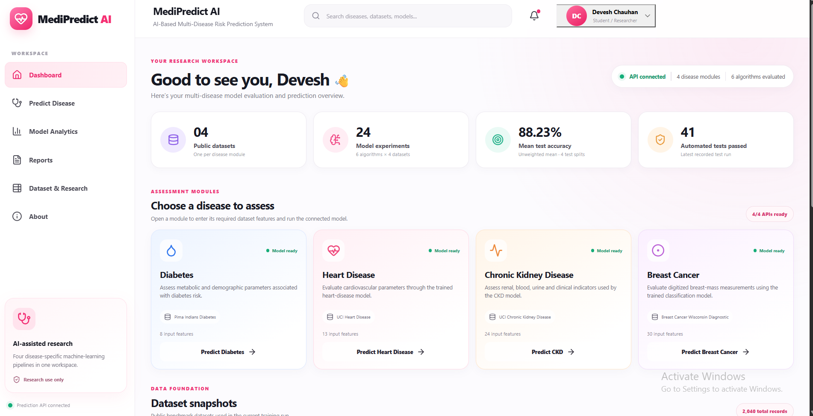

## 2. Disease Prediction Interfaces

### 2.1 Diabetes Prediction Form

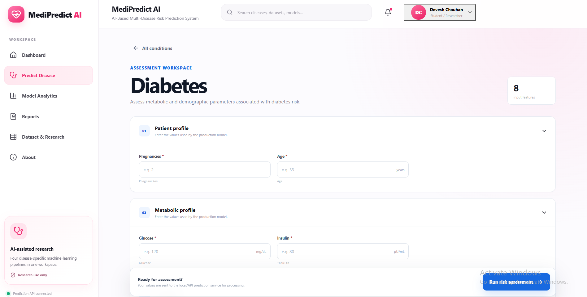

### 2.2 Heart Disease Prediction Form

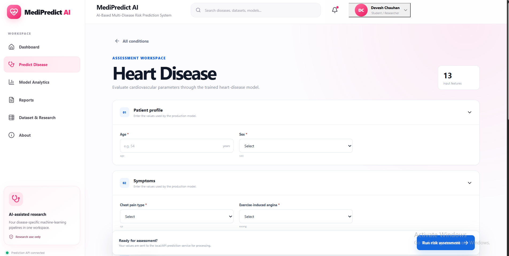

### 2.3 Chronic Kidney Disease Prediction Form

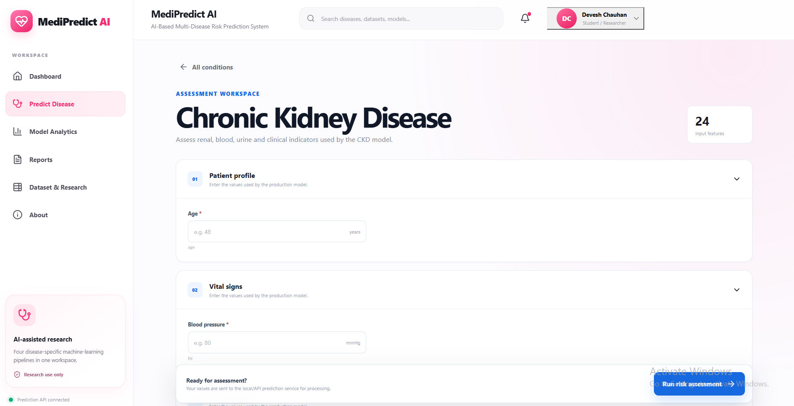

### 2.4 Breast Cancer Prediction Form

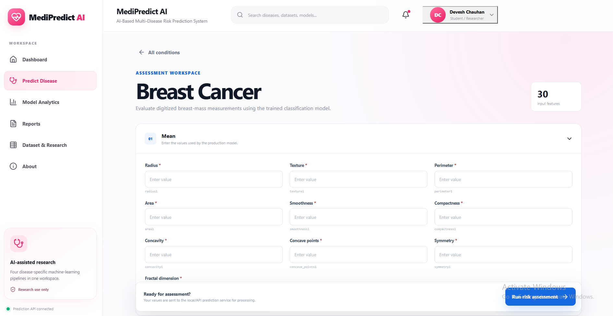

### 2.5 Diabetes Prediction Interface

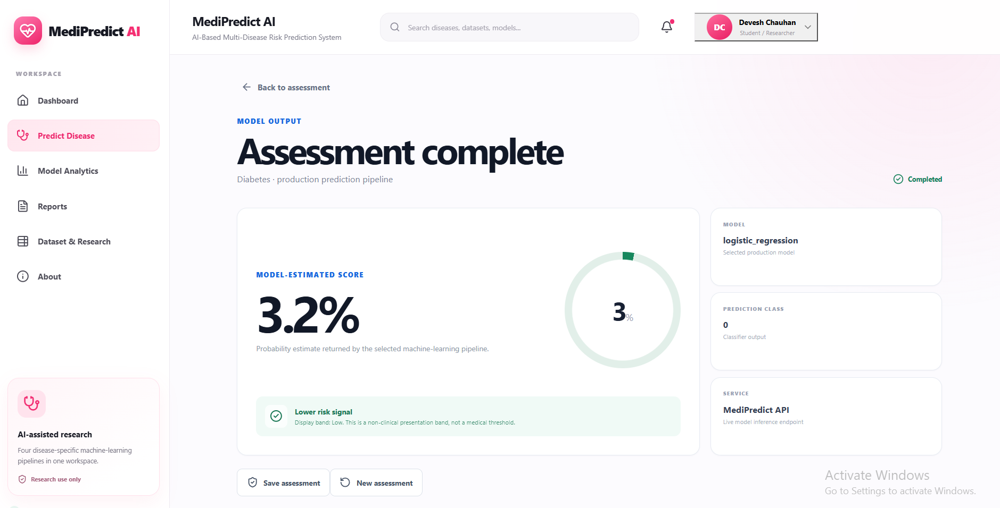

## 3. Model Analytics and Evaluation

### 3.1 Model Performance Overview

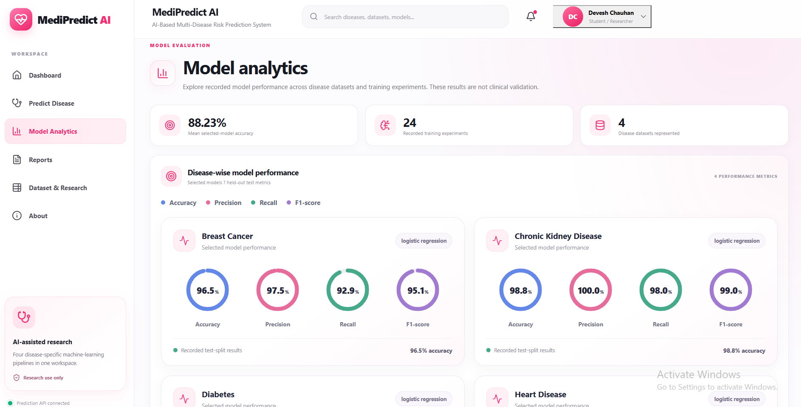

### 3.2 ROC-AUC Comparison

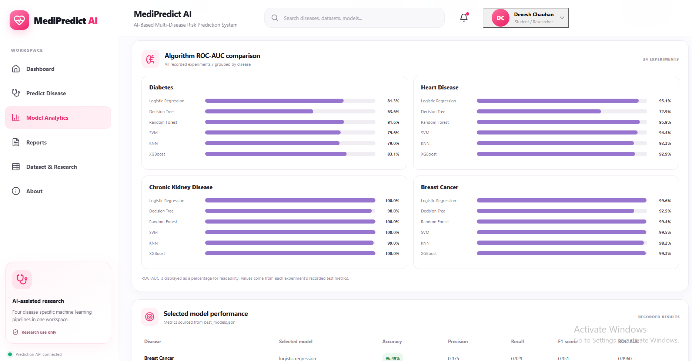

### 3.3 Evaluation Table and Research Notes

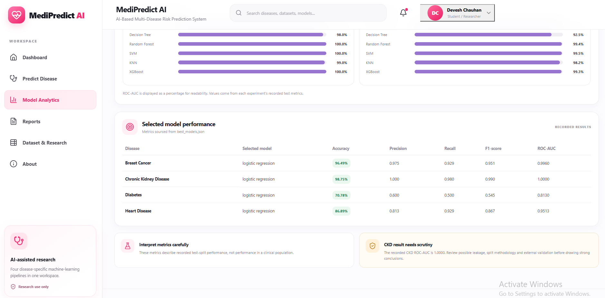

## 4. Assessment Reports and Export

### 4.1 Saved Assessment Reports

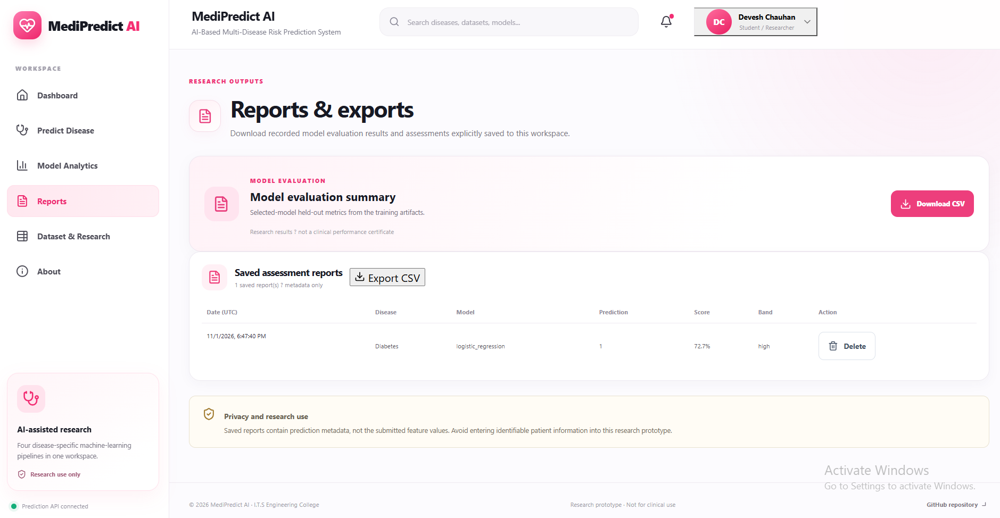

### 4.2 Model Evaluation CSV Export

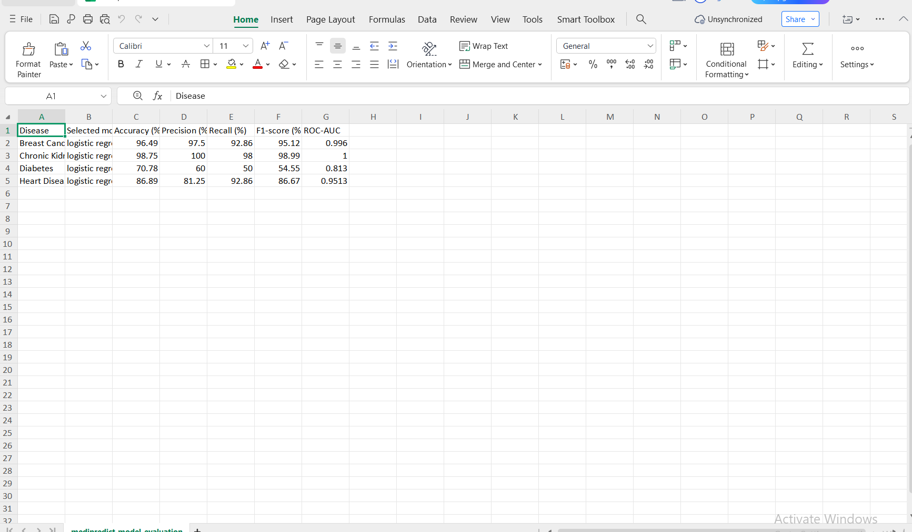

## 5. Additional Application Screenshot

The additional screenshot is retained as supplementary visual evidence. Its specific functionality should be identified after visual review.

---

## Screenshot Evidence Notes

These screenshots document the visible application interfaces and analytics. They are supplementary evidence and should be interpreted alongside the source code, API tests, model evaluation reports and research methodology.

**Directory:** `docs/screenshots/`

**Related documentation:** [Project README](../README.md), [Literature Survey](01_literature_survey.md), [High-Level Design](02_hld.md), and [Preprocessing Methodology](05_preprocessing_methodology.md).
